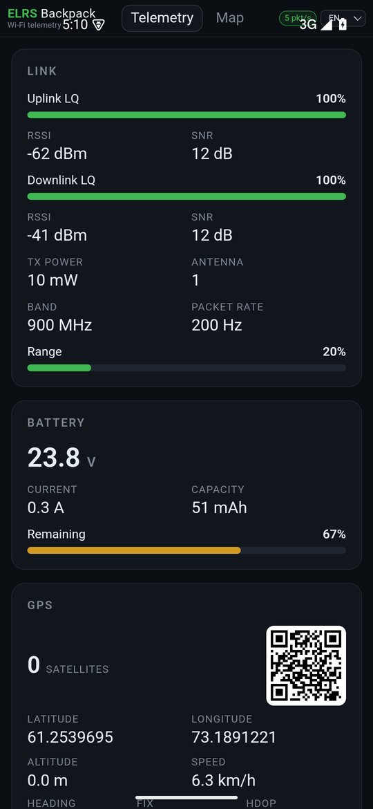
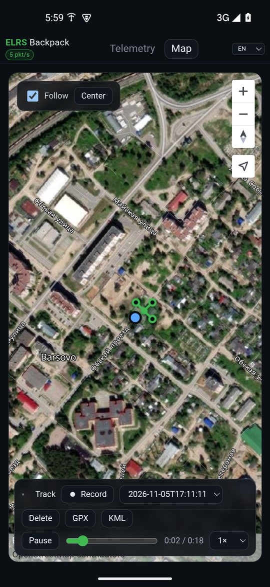

# ELRS Backpack Telemetry Viewer

Локальный веб-вьюер телеметрии ExpressLRS. Принимает CRSF-кадры, которые TX-бэкпак ELRS рассылает по Wi-Fi, и показывает их в браузере в реальном времени — без проводов, на компьютере или телефоне в той же сети.

```
Дрон / FC ──► ELRS RX ──► TX-модуль ──► ELRS Backpack ──Wi-Fi/UDP──► tlm_viewer.py ──HTTP──► браузер
```

## Возможности

- Живой дашборд: качество линка (LQ, RSSI, SNR), батарея, GPS, ориентация, баро/варио, режим полёта, диапазон, пакетрейт и Range.
- Отдельная вкладка «Карта»: MapTiler Hybrid + автоматический Esri Hi-res слой, маркер дрона, follow/center.
- Декодирование CRSF-кадров из UDP-потока бэкпака.
- Только приём: вьюер слушает эфир и ничего не отправляет модулю.
- Расчёт Range по формуле ELRS Telem Widget для ELRS 4.x.
- Определение диапазона (900 / 2.4 / dual) и пакетрейта по `rf_mode`.
- Переключение языка: English (fallback), Русский, 中文.
- HTTP API `/api/state` для интеграций.
- Оффлайн-воспроизведение записанных пакетов без дрона и аппаратуры.
- Запись GPS-трека и воспроизведение на карте: линия, маркер, перемотка и скорость.
- Только стандартная библиотека Python — внешних зависимостей нет.

## Android-приложение (APK)

В каталоге `android/` — нативная Android-обёртка на Kotlin. Тот же веб-интерфейс открывается в WebView, а приём UDP, разбор CRSF, HTTP API и запись треков реализованы на Kotlin. Python на телефоне не нужен.

<table>
  <tr>
    <td></td>
    <td></td>
  </tr>
  <tr>
    <td align="center"><sub>Телеметрия</sub></td>
    <td align="center"><sub>Карта с воспроизведением трека</sub></td>
  </tr>
</table>

- Приложение принимает телеметрию на UDP `14550` и поднимает локальный HTTP-сервер на `127.0.0.1:8080`.
- Интерфейс — встроенная копия страницы из `tlm_viewer.py`, открывается автоматически.
- Работает в foreground-сервисе с уведомлением, держит Wi-Fi/CPU lock. Остановка — кнопка «Стоп» в уведомлении или «Закрыть приложение» внизу вкладки «Телеметрия»; если идёт запись трека, приложение попросит подтвердить её прерывание.
- Треки сохраняются в приватном каталоге приложения (`files/tracks`) или в папке, выбранной в настройках.
- HTTP доступен только на самом телефоне (loopback), в отличие от Python-версии с `0.0.0.0`.
- Страница также открывается в браузере телефона: `http://127.0.0.1:8080`.
- Во вкладке «Телеметрия» есть раскрывающиеся разделы «Настройки» и «Краткое руководство».
- В настройках: UDP-порт (применяется сразу), папка треков через системный выбор (SAF), статус разрешений, таймаут отпускания блокировок при отсутствии данных (по умолчанию 5 мин; `0`/пусто — никогда), автозапись при появлении 3D-фикса и авто-стоп записи при потере телеметрии (по умолчанию 10 с; `0` — никогда).
- Уведомления и исключение из оптимизации батареи запрашиваются при первом запуске; разрешения уровня установки выдаются автоматически. Повторно запросить их можно из настроек.
- Foreground-уведомление показывает статус приёма (`N пак/с · всего M` / «ожидание данных»); во время записи трека добавляются пометка «Записывается трек», красный акцент и действие «Стоп записи». Уведомление сгруппировано с alert-уведомлением об отсутствии данных, чтобы в шторке был один блок. Если данных нет дольше заданного таймаута (по умолчанию 5 мин), приложение отпускает wake/Wi-Fi/multicast locks, оставляет сервис и показывает звуковое уведомление. `0` или пусто — никогда не отпускать. При открытии приложения или возобновлении данных locks захватываются снова.
- При смене папки треки копируются в новую; запись на это время нужно остановить.

Сборка:

```bash
cd android
./gradlew assembleDebug
```

APK: `android/app/build/outputs/apk/debug/app-debug.apk`.

Требуется JDK 17+ и Android SDK 35 (`ANDROID_HOME` или `android/local.properties`). Можно открыть `android/` в Android Studio и собрать через Run/Build. Подробная настройка toolchain, CI и команды регрессии — в `DEVELOP.md`.

CI: `.github/workflows/android-apk.yml` собирает debug APK на push/PR и вручную; готовый APK доступен как артефакт `elrs-backpack-debug-apk` на странице запуска GitHub Actions.

Релизы: `.github/workflows/release-apk.yml` по тегу `v*` или вручную собирает подписанный release APK и прикрепляет `ELRS-Backpack-<tag>.apk` к GitHub Release. Debug APK остаётся тестовым артефактом.

Установка на телефон:

```bash
adb install -r android/app/build/outputs/apk/debug/app-debug.apk
```

HTTP-порт задан в `TelemetryService.kt` (`HTTP_PORT`), UDP-порт меняется в настройках приложения. Ключ MapTiler подставляется при сборке из `MAPTILER_KEY` или `maptiler.key`; в исходниках только placeholder, поля ввода нет.

## Требования

- Android 7.0+ для APK или Python 3.8+ для веб-вьюера.
- ELRS TX-бэкпак с поддержкой Wi-Fi-телеметрии (Backpack 1.5.7+; для некоторых ESP32-C3 — master-ветка).
- Компьютер/телефон в той же Wi-Fi-сети, что и бэкпак.
- Свободные порты: UDP `14550` (приём телеметрии), TCP `8080` (веб-интерфейс).
- Доступ в интернет и ключ MapTiler для вкладки «Карта» (задаётся локально или через секрет CI; см. `DEVELOP.md`).

## Python-вьюер

Веб-интерфейс для ПК или телефона в браузере.

1. Включите бэкпак Wi-Fi-телеметрии:
   - ELRS Lua-скрипт на аппаратуре → `Backpack` → `Telemetry` → `WiFi`.
   - Не используйте `WiFi Connectivity` — это режим прошивки.
2. Подключите телефон/ПК к той же сети, что и бэкпак:
   - либо к домашней сети/хот-споту, куда бэкпак подключён при прошивке;
   - либо напрямую к точке `ExpressLRS TX Backpack XXXXXX`, пароль `expresslrs`.
3. Запустите вьюер:

   ```bash
   python3 tlm_viewer.py
   ```

4. Откройте `http://localhost:8080` или `http://<ip-компьютера>:8080` (например, с телефона).

### Параметры запуска

```bash
python3 tlm_viewer.py --udp-port 14550 --http-host 0.0.0.0 --http-port 8080
```

| Параметр | По умолчанию | Назначение |
|---|---|---|
| `--udp-port` | `14550` | UDP-порт, куда бэкпак шлёт CRSF-телеметрию |
| `--http-host` | `0.0.0.0` | Адрес веб-сервера (`0.0.0.0` — доступен в сети) |
| `--http-port` | `8080` | Порт веб-интерфейса |

## Что показывается

| Карточка | Данные |
|---|---|
| Линк | Uplink/Downlink LQ, RSSI, SNR, TX power, активная антенна, диапазон, пакетрейт, Range |
| Батарея | Напряжение, ток, израсходованная ёмкость, остаток % |
| GPS | Координаты, высота, скорость, курс, 3D/2D/нет фикса, HDOP, число спутников, QR с geo-координатами (в Android-приложении — по последнему 3D-фиксу) |
| Полёт | Режим полёта, барометрическая высота, варио, GPS-время, устройство |
| Ориентация | Pitch / roll / yaw и авиагоризонт |
| Приём | Пакетов/с, всего пакетов, возраст данных, типы CRSF-кадров с описаниями |

Поддерживаемые кадры: `0x02` GPS, `0x03` GPS Time, `0x06` GPS Extended, `0x07` Vario, `0x08` Battery, `0x09` Baro Altitude, `0x14` Link Statistics, `0x1E` Attitude, `0x21` Flight Mode, `0x29` Device Info. Остальные типы попадают в таблицу кадров как `Unknown`, а их последние payload доступны в API (`unknown`).

QR строится по последним известным координатам: в Android-приложении `gps_last` обновляется только на 3D-фиксе, в Python-вьюере — на 2D/3D-фиксе. 3D определяется по `fix_type` из `0x06`, если он есть, иначе по числу спутников (≥4); 2D — ≥3. `flight_mode` для определения фикса не используется. В Android-приложении запись трека не фильтрует точки по фиксу: пока запись активна, сохраняется каждый GPS-кадр `0x02` вместе с его `fix_type`; в Python-вьюере точки пишутся только при 3D-фиксе. Нажатие на QR открывает точку в приложении навигации: в Android-приложении — через системный `geo:` intent (приложение по умолчанию или выбор из установленных), в браузере — через обработчик `geo:` ОС.

## Карта

Вкладка «Карта» показывает положение дрона на **MapTiler**, слой **Hybrid** (спутник + подписи).

Ключ MapTiler не хранится в репозитории: в исходниках стоит placeholder `"__MAPTILER_KEY__"`. Локально ключ кладётся в `maptiler.key` (git-ignored) или задаётся через `MAPTILER_KEY`; в GitHub Actions — через секрет `MAPTILER_KEY`. Поля ввода ключа в UI нет. Подробнее — в `DEVELOP.md`.

Ключ можно создать на `https://cloud.maptiler.com/` и ограничить по **Allowed HTTP origin** (`localhost`, `127.0.0.1`).

Прямая ссылка на вкладку: `http://localhost:8080/?tab=map`.

На карте: маркер дрона, координаты/спутники/скорость, переключатель **Follow** (автоцентрирование) и кнопка **Center**. Если GPS-фикса нет, показывается «Нет GPS-фикса», а маркер остаётся на последней известной точке.

Используется MapTiler SDK JS (`MapStyle.HYBRID`). На бесплатном тарифе MapTiler автоматически показывает свой логотип и атрибуцию — это условие тарифа. Лимиты Free: 5k сессий и 100k запросов в месяц, для личных/некоммерческих проектов.

На Free-плане high-res слой `satellite-v2` отдаёт 403 на zoom ≥ 12, поэтому вьюер подменяет спутниковую подложку на `satellite-mediumres` (10 м/пиксель, zoom 0–13) с overzoom на больших зумах. Векторные подписи и дороги при этом остаются детальными.

Дополнительно при zoom ≥ 12 автоматически включается слой **Esri World Imagery**. Он даёт высокое разрешение поверх 10-метровой подложки; подписи и дороги остаются от MapTiler. Если Esri недоступен, останется MapTiler mediumres. Esri — американский сервис, поэтому доступность и условия использования из РФ не гарантированы; атрибуция Esri выводится на карте.

## Запись и воспроизведение трека

На вкладке «Карта» есть панель трека. Она свёрнута по умолчанию — раскрывается кликом по заголовку «Трек».

- **Запись / Стоп** — в Android-приложении пишет каждый GPS-кадр `0x02`, пока запись активна, включая 2D и отсутствие фикса; тип фикса сохраняется в точке. В Python-вьюере точки пишутся только при 3D-фиксе (обычно ≥4 спутников).
- Список сохранённых треков; выбор в списке сразу загружает трек. Кнопки **Удалить**, **GPX**, **KML** показываются, когда трек выбран.
- **GPX/KML** в Android-приложении сохраняются в `Download/ELRS Backpack/` и сопровождаются сообщением с путём.
- Воспроизведение: **Играть / Пауза**, перемотка, скорость `1× / 2× / 5× / 10×` — появляется после загрузки трека.
- При включённом **Follow** карта следует за маркером воспроизведения.
- После остановки записи трек автоматически загружается для просмотра.
- Папку хранения можно сменить в настройках Android-приложения; существующие треки копируются в новую папку.

Частота точек записи равна частоте GPS-кадров `0x02` в ELRS-потоке: Android-приложение пишет каждый пришедший кадр без прореживания, Python-вьюер — только кадры с 3D-фиксом. В тестовом захвате это ~0.2–0.3 Гц (кадр раз в 3–5 с), что ограничено telemetry ratio/расписанием сенсоров FC, а не вьюером.

Треки сохраняются на сервере в `tracks/<id>.json`, где `id` — `track_YYYYmmdd_HHMMSS`. Формат точки (сокращённо):

```json
{"t": 1.287, "lat": 61.2538884, "lon": 73.1888693, "alt": 140.0,
 "speed": 7.6, "heading": 107.7, "sats": 4,
 "fix_type": 3, "fix_type_computed": false,
 "telemetry": {"gps": {"lat": 61.2538884}, "gps_ext": {"fix_type": 3},
               "link": {"lq": 100}, "battery": {"voltage": 23.8}}}
```

Android-приложение пишет `fix_type`, `fix_type_computed` и вложенный `telemetry` со снимком GPS/линка/батареи/ориентации; Python-вьюер пишет только базовые поля точки. `t` — секунды от начала записи. Длительность трека — время последней точки.

HTTP API:

| Метод | Путь | Назначение |
|---|---|---|
| `POST` | `/api/record/start` | начать запись |
| `POST` | `/api/record/stop` | остановить и сохранить трек |
| `GET` | `/api/record?since=N` | состояние записи и новые точки начиная с индекса N |
| `GET` | `/api/tracks` | список сохранённых треков |
| `GET` | `/api/tracks/<id>` | точки трека |
| `DELETE` | `/api/tracks/<id>` | удалить трек |
| `GET` | `/api/settings` | UDP-порт, папка треков, статус записи, таймаут энергосбережения |
| `POST` | `/api/settings` | изменить UDP-порт (`{"udp_port": 14551}`) |

`/api/settings` реализован в Android-приложении.

## Диапазон, пакетрейт и Range

Диапазон и пакетрейт определяются по полю `rf_mode` из `0x14` для ELRS 4.x:

| `rf_mode` | Диапазон |
|---|---|
| `0…11` | 900 MHz |
| `20…36` | 2.4 GHz |
| `100…101` | Dual |

Основные пороги чувствительности для расчёта Range (ELRS 4.x):

| Диапазон | Пакетрейт → порог, dBm |
|---|---|
| 900 MHz | 25 Hz −123, 50 Hz −120, 100 Hz −117, 100 Hz/8ch −112, 200 Hz −112, 50 Hz DVDA −112 |
| 2.4 GHz | 50 Hz −115, 150 Hz −112, 100 Hz/8ch −112, 250 Hz −108, 333 Hz/8ch −105, 500 Hz −105 |

Формула:

```
range% = round(100 * (clamp(rssi, max=-50) + 50) / (minrssi + 50))
```

- Используется RSSI активной антенны.
- RSSI сильнее −50 dBm обрезается до −50 dBm.
- `minrssi` — порог чувствительности для текущего `rf_mode`.
- Значение слегка сглаживается, чтобы не дёргалось.

Важно: **Range — это не расстояние в метрах**, а запас до порога чувствительности. `0 %` — очень сильный сигнал, `100 %` — на пределе линка. Динамическая мощность TX не учитывается: при её росте RSSI увеличивается, а Range% падает.

TX power в CRSF — это enum; вьюер переводит его в мВт: `0→0`, `1→10`, `2→25`, `3→100`, `4→500`, `5→1000`, `6→2000`, `7→250`, `8→50`.

## API

`GET /api/state` возвращает текущий снимок:

```json
{
  "link": {
    "rssi1": -66, "rssi2": 0, "lq": 100, "snr": 12,
    "active_ant": 0, "rf_mode": 5, "tx_power": 1,
    "rssi_d": -37, "lq_d": 100, "snr_d": 12
  },
  "battery": {"voltage": 23.8, "current": 0.1, "capacity": 50, "remaining": 67},
  "gps": {"lat": 61.25389, "lon": 73.18889, "speed": 3.8, "heading": 29, "alt": 163, "sats": 4, "fix": true, "fix3d": true},
  "attitude": {"pitch": 0.5, "roll": -3.3, "yaw": -125.9},
  "baro": {"alt": 0.5, "vario": 0.0},
  "vario": 0.0,
  "flight_mode": "AIR*",
  "frames": {"2": 13, "7": 16, "8": 13, "9": 14, "20": 230, "30": 16, "33": 16},
  "stats": {"total": 311, "pps": 5, "age": 0.12}
}
```

Ключи в `frames` — десятичные значения типов (например, `20` = `0x14`).

## Оффлайн-воспроизведение

Файл записи — JSONL, одна UDP-нагрузка на строку:

```json
{"t": 0.123456, "src": "192.168.0.41:14555", "data": "24583c00..."}
```

- `t` — секунды от начала записи;
- `src` — исходный адрес;
- `data` — полная UDP-нагрузка в hex;
- последняя строка может быть `{"meta": {...}}` — replay её игнорирует.

Тестовый захват обезличен: координаты перенесены в район Барсово (Сургутский район), исходный адрес источника заменён на условный `192.168.0.41:14555`. Треки в `tracks/` также перенесены в эту точку.

Запуск:

```bash
# выключить дрон и бэкпак, перезапустить вьюер
python3 replay.py testdata/tlm_20261105_111628.jsonl

# опции
python3 replay.py testdata/tlm_20261105_111628.jsonl --loop
python3 replay.py testdata/tlm_20261105_111628.jsonl --speed 2
python3 replay.py testdata/tlm_20261105_111628.jsonl --speed 0
```

По умолчанию пакеты отправляются на `127.0.0.1:14550`. `--speed 0` отправляет всё сразу, `--loop` повторяет запись. Подробнее — в `AGENTS.md`.

## Мультиязычность

- Язык определяется по браузеру.
- Выбор сохраняется в `localStorage`.
- Принудительно: `?lang=en`, `?lang=ru`, `?lang=zh`.
- Английский — fallback для отсутствующих переводов.

## Структура проекта

```
tlm_viewer.py   вьюер: UDP-приём, парсинг CRSF, HTTP-сервер и веб-интерфейс
android/        Android-приложение на Kotlin (WebView + UDP/CRSF/HTTP), APK
replay.py       оффлайн-воспроизведение JSONL-записей
testdata/       записанные сессии телеметрии
tracks/         сохранённые GPS-треки (JSON)
AGENTS.md       заметки/skill для агентов (как воспроизводить оффлайн)
docs/           скриншоты для README
DEVELOP.md      настройка toolchain, сборка, CI, ключ MapTiler и регрессия
LICENSE         MIT
.github/        GitHub Actions: APK-артефакт и релизы
```

## Диагностика

| Проблема | Что проверить |
|---|---|
| «Нет данных» | Бэкпак в той же сети; `Telemetry = WiFi`; порт UDP 14550 свободен; firewall |
| Бэкпак не поднимает Wi-Fi | Backpack 1.5.7+; для ESP32-C3 — master или workaround `Link Mode = MAVLink` |
| Range показывает `—` | Неизвестный `rf_mode` или режим без известного порога |
| Порт 14550 занят | Остановите другой процесс; вьюер должен быть слушателем |
| После смены порта нет данных | Настройте бэкпак на новый UDP-порт из настроек |
| Не выбирается папка треков | Остановите запись; выберите папку, доступную для записи |
| Живые и записанные данные смешались | Выключите бэкпак перед `replay.py` |
| С телефона не открывается | Порт 8080 в firewall; телефон в той же сети |
| Карта не загружается | Проверьте, что задан ключ MapTiler (`maptiler.key`/`MAPTILER_KEY`/секрет CI) и разрешён origin; смотрите консоль браузера |
| На карте «Нет GPS-фикса» | У дрона нет GPS-фикса; маркер появится после получения координат |

## Ограничения

- Нет аутентификации: веб-интерфейс и API доступны всем в сети. Используйте доверенную локальную сеть.
- Range-таблица рассчитана на ELRS 4.x; для старых v3 значения `rf_mode` другие.
- Для режимов без табличного порога Range не считается.
- Карта требует интернет и ключ MapTiler. Если ключ не задан, отозван или origin не разрешён, карта не загрузится.
- Выбранная для треков папка должна быть доступна для записи; при смене папки старые треки копируются.
- В Android-приложении точки трека пишутся на каждый GPS-кадр, пока запись активна (включая 2D и отсутствие фикса); в Python-вьюере — только при 3D-фиксе. Незавершённая запись хранится в памяти и сохраняется на диск по кнопке «Стоп» (в Android также по авто-стопу); при подтверждённом закрытии Android-приложения и при падении процесса она теряется.
- Запись новых сессий в репозиторий не встроена; формат JSONL описан выше, текущий сэмпл — `testdata/tlm_20261105_111628.jsonl`.

## Лицензия

MIT. См. `LICENSE`.

## Поддержать автора

Вы можете отблагодарить автора за потраченные токены и время на Rutube-канале [Рассказы ветра](https://rutube.ru/channel/36225989/).
