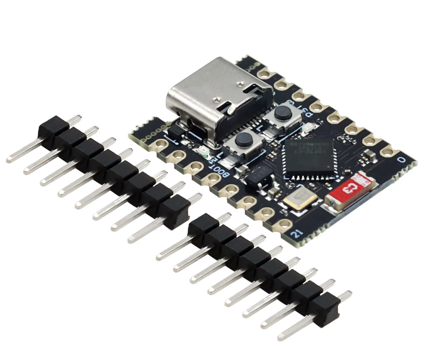

# ELRS Backpack Telemetry

[English follow Russian](#english)

Android-приложение для телеметрии ExpressLRS: показывает данные в двух вкладках — «Телеметрия» и «Карта». Карта работает при наличии интернета. Трек вместе с телеметрией можно записать вручную или автоматически и воспроизвести на карте позже.

Есть два способа получить телеметрию:

- **Wi-Fi (по умолчанию)** — не требует дополнительного железа. Подходит, чтобы быстро начать.
- **ESP-NOW по USB (рекомендуется)** — меньше засоряет радиоэфир: нет Wi-Fi AP/beacons и трафика телефона в 2.4 ГГц. Нужен USB-донгл на ESP32-C3 с native USB, OTG и кабель.

```text
Wi-Fi:    Дрон / FC ──► ELRS RX ──► TX-модуль ──► Backpack ──Wi-Fi/UDP──► приложение
ESP-NOW:  Дрон / FC ──► ELRS RX ──► TX-модуль ──► Backpack ──ESP-NOW──► USB-донгл ──USB──► приложение
```

<table>
  <tr>
    <td></td>
    <td></td>
  </tr>
  <tr>
    <td align="center"><sub>Телеметрия</sub></td>
    <td align="center"><sub>Карта и трек</sub></td>
  </tr>
</table>

## Установка

1. Откройте [последний релиз](https://github.com/voffmail/ELRS-Backpack-Telemetry/releases/latest).
2. Скачайте APK `ELRS-Backpack-Telemetry-vX.Y.Z.apk`.
3. Установите его на телефон с Android 7.0+. Разрешите установку из неизвестных источников.
4. Обновления устанавливаются поверх предыдущей версии.

## Быстрый старт

### Wi-Fi (по умолчанию)

1. Подключите телефон и ELRS TX Backpack к одной Wi-Fi-сети.
2. На аппаратуре задайте: ELRS Lua → Backpack → Telemetry → WiFi. Не используйте «WiFi Connectivity».
3. Запустите приложение. По умолчанию используется UDP-порт `14550`; если он изменён, укажите тот же порт в настройках (шестерёнка в шапке).

### ESP-NOW по USB (рекомендуется)

1. Прошейте USB-донгл ESP32-C3 с native USB — через [Web Flasher](https://voffmail.github.io/ELRS-Backpack-Telemetry/) или PlatformIO (см. ниже).
2. На аппаратуре задайте: ELRS Lua → Backpack → Telemetry → ESP-NOW.
3. Подключите донгл к телефону через OTG и разрешите доступ к USB.
4. Откройте настройки (шестерёнка в шапке), выберите источник **«ESP-NOW по USB»**.
5. Укажите binding phrase или ручной UID, совпадающие с бэкпаком.

Индикатор в приложении зелёный, когда линк с дроном живой. Если идут только
кадры `0x14` с `LQ=0`, приложение покажет «нет связи с дроном», а уведомление —
«нет связи с дроном» или «нет связи с аппаратурой» в зависимости от ситуации.

## Прошивка USB-донгла и [Web Flasher](https://voffmail.github.io/ELRS-Backpack-Telemetry/)



В репозитории есть прошивка ESP32-C3 для USB-донгла (ESP-NOW → CRSF по USB), симулятор бэкпака и генератор web-flasher.

Сборка прошивки (PlatformIO ставится локально в `.toolchain/venv`):

```bash
./init.sh
./tools/pio run -d firmware -e esp32-c3-usb
```

Прошивка: `firmware/.pio/build/esp32-c3-usb/firmware.bin`. Используется только
native-USB ESP32-C3 (например, Super Mini).

[Web Flasher](https://voffmail.github.io/ELRS-Backpack-Telemetry/) собирается из merged-образа (`build/firmware-merged.bin`) скриптом `scripts/make_webflasher.py`; workflow `.github/workflows/webflasher.yml` публикует сайт на GitHub Pages. Для публикации один раз включите **Settings → Pages → Source: GitHub Actions**.

Android-приложение и прошивка используют общий `.toolchain/`: Android ставится через `bash scripts/setup-toolchain.sh`, прошивка — через `./init.sh`.

## Документация

- [Запуск на компьютере: Wi-Fi и ESP-NOW](docs/PC-RUN-WIFI-VS-ESPNOW.md) — два способа запуска `tlm_viewer.py`, мост для USB-донгла и настройка.
- [Wi-Fi vs ESP-NOW](docs/BACKPACK-TELEMETRY-WIFI-VS-ESPNOW.md) — что выбрать, требования и ограничения.
- [DESIGN.md](docs/DESIGN.md) — архитектура и протоколы USB-донгла.
- [REFERENCE.md](docs/REFERENCE.md) — API, CRSF-кадры, Range, карта, диагностика.
- [ELRS Rate & Telemetry Cheat Sheet](docs/ELRS-RATE-TELEMETRY-CHEATSHEET.md) — packet rate и telemetry ratio.

## Разработчикам

Сборка, toolchain, CI, релизы, ключ MapTiler и команды проверки — в [DEVELOP.md](DEVELOP.md).

Для ПК есть Python-вьюер (Wi-Fi/UDP) — удобен для разработки и запуска на ноутбуке в поле. Для USB-донгла на ПК используется `tools/serial_bridge.py`.

Исходный код: [github.com/voffmail/ELRS-Backpack-Telemetry](https://github.com/voffmail/ELRS-Backpack-Telemetry).

## Поддержать автора

[Рассказы ветра на Rutube](https://rutube.ru/channel/36225989/)

## Лицензия

MIT. См. [LICENSE](LICENSE).

---

## English

**ELRS Backpack Telemetry** is an Android app for ExpressLRS telemetry: it shows data in two tabs, Telemetry and Map. The map requires internet access. Tracks can be recorded together with telemetry, manually or automatically, and played back on the map later.

There are two ways to receive telemetry:

- **Wi-Fi (default)** — no extra hardware. The easiest way to start.
- **ESP-NOW via USB (recommended)** — less RF pollution: no Wi-Fi AP/beacons and no phone traffic in 2.4 GHz. Requires an ESP32-C3 USB dongle with native USB, OTG and a data cable.

```text
Wi-Fi:    Drone / FC ──► ELRS RX ──► TX module ──► Backpack ──Wi-Fi/UDP──► app
ESP-NOW:  Drone / FC ──► ELRS RX ──► TX module ──► Backpack ──ESP-NOW──► USB dongle ──USB──► app
```

### Installation

1. Open the [latest release](https://github.com/voffmail/ELRS-Backpack-Telemetry/releases/latest).
2. Download `ELRS-Backpack-Telemetry-vX.Y.Z.apk`.
3. Install it on a phone running Android 7.0+. Allow installation from unknown sources.
4. Updates install over the previous version.

### Quick start

#### Wi-Fi (default)

1. Connect the phone and the ELRS TX backpack to the same Wi-Fi network.
2. On the radio, set: ELRS Lua → Backpack → Telemetry → WiFi. Do not use “WiFi Connectivity”.
3. Start the app. It listens on UDP port `14550` by default; if the port was changed, set the same port in Settings (gear icon in the header).

#### ESP-NOW via USB (recommended)

1. Flash the ESP32-C3 native-USB dongle via the [Web Flasher](https://voffmail.github.io/ELRS-Backpack-Telemetry/) or PlatformIO (see below).
2. On the radio, set: ELRS Lua → Backpack → Telemetry → ESP-NOW.
3. Connect the dongle to the phone over OTG and allow USB access.
4. Open Settings (gear icon in the header) and select **“ESP-NOW via USB”**.
5. Set the same binding phrase or manual UID as the backpack.

The app indicator is green while the drone link is alive. If only `0x14` frames
with `LQ=0` arrive, the app shows “no drone link”, and the notification says
“no drone link” or “no backpack link” depending on the situation.

### Dongle firmware and [Web Flasher](https://voffmail.github.io/ELRS-Backpack-Telemetry/)


The repository includes ESP32-C3 firmware for the ESP-NOW USB dongle (ESP-NOW → CRSF over USB), a backpack simulator and the web-flasher generator.

Build the firmware (PlatformIO is installed locally into `.toolchain/venv`):

```bash
./init.sh
./tools/pio run -d firmware -e esp32-c3-usb
```

Firmware: `firmware/.pio/build/esp32-c3-usb/firmware.bin`. Only native-USB
ESP32-C3 boards (e.g. Super Mini) are supported.

The [Web Flasher](https://voffmail.github.io/ELRS-Backpack-Telemetry/) is built from the merged image (`build/firmware-merged.bin`) with `scripts/make_webflasher.py`; `.github/workflows/webflasher.yml` publishes the site to GitHub Pages. Enable **Settings → Pages → Source: GitHub Actions** once.

The Android app and the firmware share `.toolchain/`: set up Android with `bash scripts/setup-toolchain.sh`, and the firmware with `./init.sh`.

### Documentation

- [Running on a PC: Wi-Fi and ESP-NOW](docs/PC-RUN-WIFI-VS-ESPNOW.md) — two ways to run `tlm_viewer.py`, the USB dongle bridge and configuration.
- [Wi-Fi vs ESP-NOW](docs/BACKPACK-TELEMETRY-WIFI-VS-ESPNOW.md) — which one to choose, requirements and limits.
- [DESIGN.md](docs/DESIGN.md) — USB dongle architecture and protocols.
- [REFERENCE.md](docs/REFERENCE.md) — API, CRSF frames, Range, map, troubleshooting.
- [ELRS Rate & Telemetry Cheat Sheet](docs/ELRS-RATE-TELEMETRY-CHEATSHEET.md) — packet rate and telemetry ratio.

### For developers

Build, toolchain, CI, releases, MapTiler key and regression checks are described in [DEVELOP.md](DEVELOP.md).

A Python viewer (Wi-Fi/UDP) is available for PC. For the USB dongle on a PC use `tools/serial_bridge.py`.

Source code: [github.com/voffmail/ELRS-Backpack-Telemetry](https://github.com/voffmail/ELRS-Backpack-Telemetry).

### Support the author

[Рассказы ветра on Rutube](https://rutube.ru/channel/36225989/)

### License

MIT. See [LICENSE](LICENSE).
